# 功能介绍
我编写的这个软件，我是为了解决一些我在工作中出现的比较烦的问题。
我们使用Udp/串口进行通信。
我方作为上位机，需要跟各种各样的分机进行通信。
通信就会涉及到两方对报文。
有时候对方的分机没有准备好，我们需要去模拟它给我方发送报文。
这时候会涉及到去组包，给对方的报文的结构体赋值。
有时候需要去联合调试，判断是我方的报文组包出现了问题，还是对方的解包出现了问题。
这时候也涉及到了组包/解包。
实际上我的工作中，通信相关的，都会涉及到组包和解包。
我的这个软件可以实现：
输入 ： 一个C++头文件（结构体）
```
#pragma pack(1)
// 报文头
typedef struct tagSysBDPHead
{
    unsigned int   m_GeneralFlag;     // 通用标识
    unsigned short m_Command;         // 命令标识码
    unsigned short m_nLength;         // 报文长度
    unsigned int   m_time;            // 时戳
    unsigned short m_MessageNumber;   // 信息编号
    unsigned short m_uReserved;       // 备用
    unsigned short m_SAddr;           // 发方地址
    unsigned short m_RAddr;           // 收方地址
}sysBDPHead;

typedef struct tagFiberPeriodic
{
    sysBDPHead     m_bdphead;           // 报文头
    unsigned short m_DataValidFlag;     // 数据有效标志
    unsigned int   m_ContWorkT;         // 持续工作时间
    unsigned int   m_HdgAng;            // 艏向角
    int            m_ShipZY;            // 纵摇
    int            m_ShipHY;            // 横摇
    int            m_HdgAngVel;         // 艏向角速度
    int            m_ShipZYAngVel;      // 纵摇角速度
    int            m_ShipHYAngVel;      // 横摇角速度
    int            m_EastVel;           // 东速
    int            m_NorthVel;          // 北速
    int            m_UpVel;             // 垂向速度
	int            m_LonG;              // 经度
    int            m_LatG;              // 纬度
    int            m_AltG;              // 高度
    unsigned char  m_uReserved[2];      // 备用
    unsigned int   m_CheckSum;          // 查验码
    unsigned int   m_TermCode;          // 报文终止符

}FiberPeriodic;

#pragma pack()
```
输出：
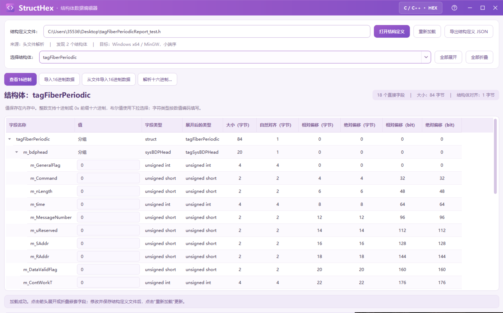


我们导入头文件后，就可以去编辑这个结构体的每个成员的值了。
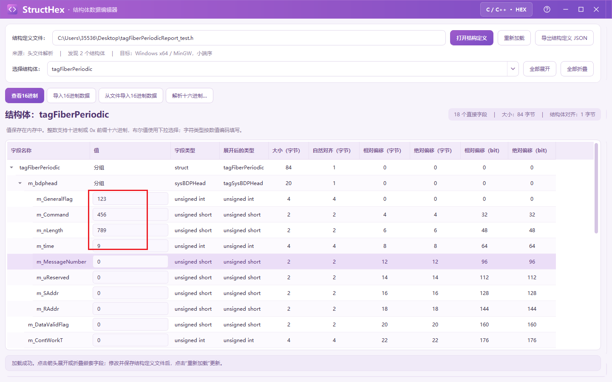


我常见的情景是：
编辑完后，可以把这部分值给复制出来
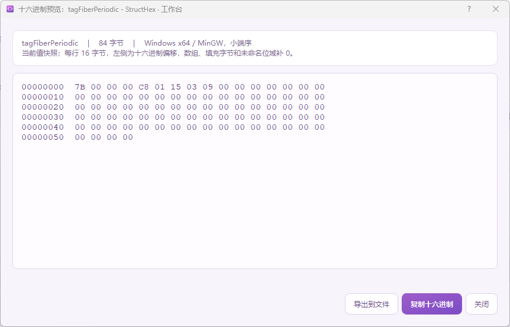

然后使用网络调试助手 发送出去，这样可以方便地进行调试工作，不管是模拟本机，还是模拟其他分机，都很好用。

同时，也可以看到，可以导出到文件：

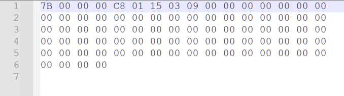


也支持  导入16进制数据

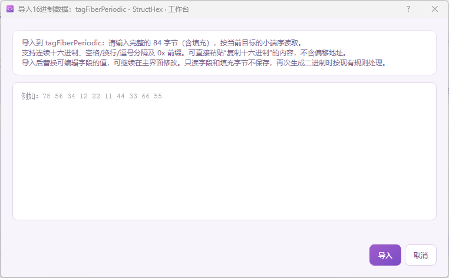

还支持从文件导入16进制数据


还有个类似的功能：
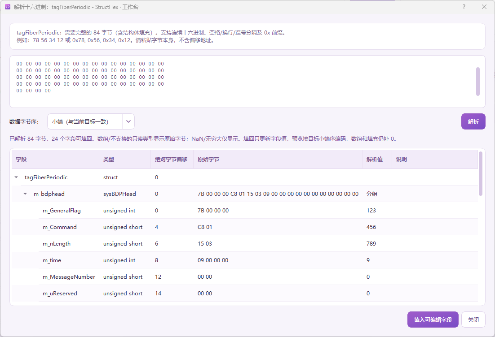
输入16进制编码，实时地解析出每个成员的值。上面修改，下面同步变化。


同时呢，我这个从xxx.h 到  内存中的信息（字段名称，字段类型，大小，字节对齐，偏移）（结构体名称） 是通过libclang来解析出来的。
xxx.h在我看来毕竟不是标准化的数据格式，依赖libclang.
所以我写了 可以 导出结构定义json，就是将这些信息导出到json文件，这样就是标准化数据了。

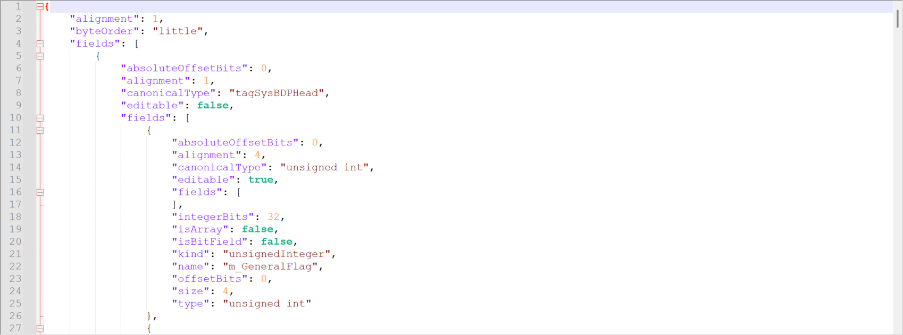

到这步，我们就可以：根据xxx.h ---> 编辑结构体，提取出它的内存中的16进制值。


我又扩展了软件功能，因为我的工作中有很大一部分重复工作是：  
根据结构体 以及它的业务解释映射关系，去编写1个对应的QWidget界面。
如果我的软件有40个结构体，我就需要绘制40个QWidget界面，很烦人。
但是我知道这部分业务实际上是有重复性的。
所以我编写了一个业务配置JSON设计器：

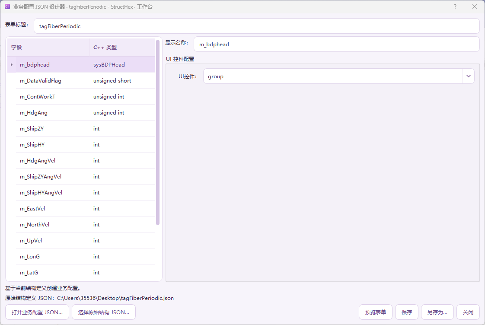

输入是之前的结构定义JSON
输出是业务配置JSON
我们可以配置每个字段的  显示名称，使用的UI控件
如果使用spinBox ，则可能需要配置这些字段：

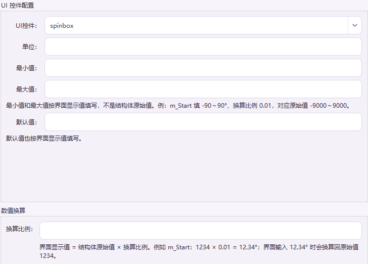

如果使用 doublespinbox:

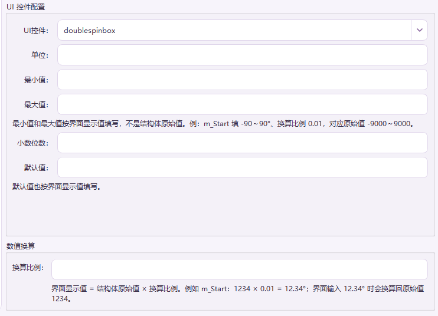

如果使用comboBox

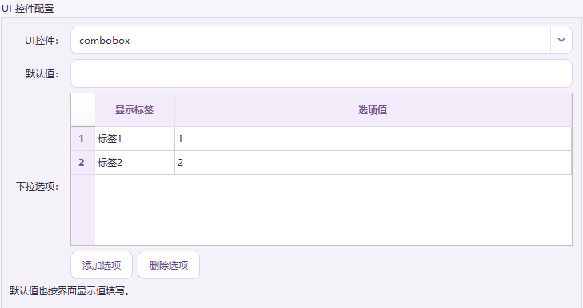

checkBox:

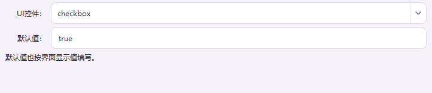

点击   ：  预览表单，可以看编辑业务表单后的效果

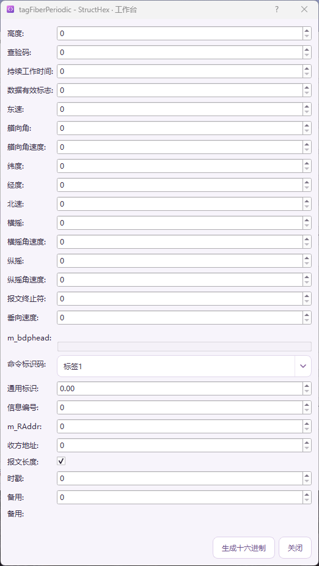

还可以生成16进制数据

现在相当于更近一步，直接可以根据真实的业务信息：得到对应结构体的16进制数据了，现在其实已经非常接近我们的上位机软件的效果了。

依然可以导出相关的业务配置JSON，可以编辑，可以导入。

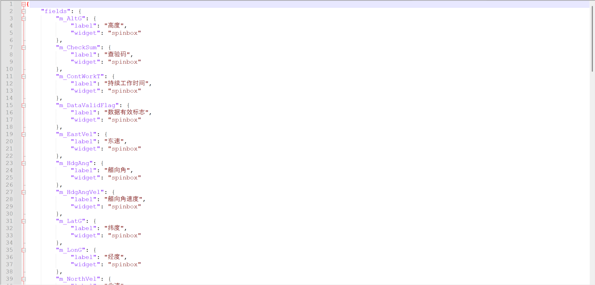


经过刚才的两个环节：
我们已经得到了结构定义json和业务配置json
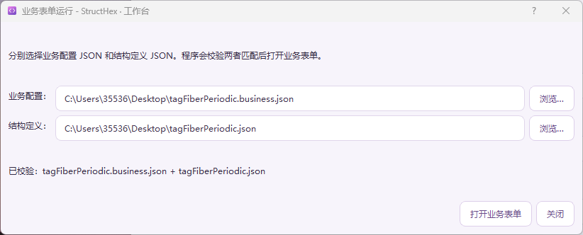
直接打开业务表单：
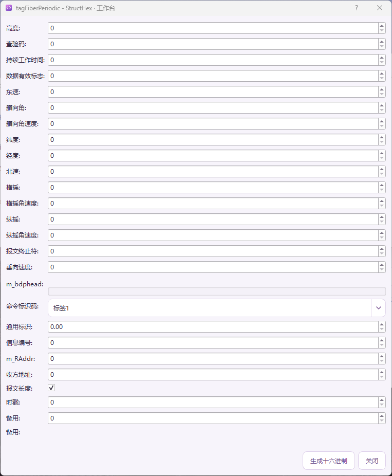

现在我们可以很方便地根据  我们需要配置的参数 得到对应的16进制编码了。
这大大地利好了我们测试和联调，排查错误的速度。

为了更近一步地方便操作：
我实现了业务数据编解码 工作台：
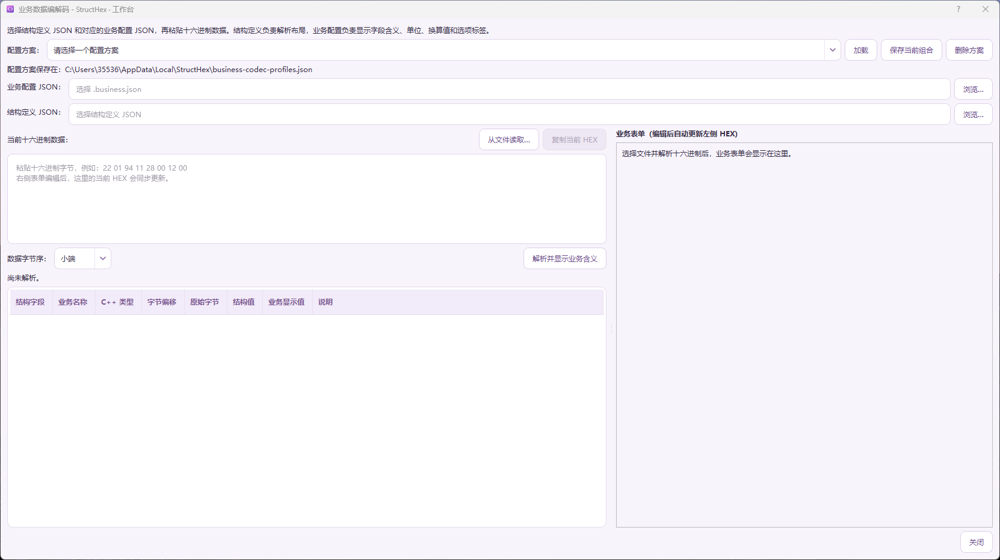

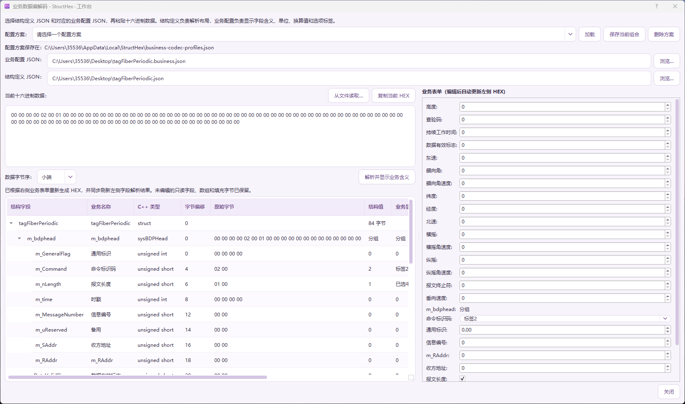

此时我们已经编辑好了业务配置JSON和 结构定义JSON

我们可以很方便地在右侧的业务表单进行编辑操作，修改后 16进制数据和 左侧的解析区域都会得到刷新。

此时呢，我们可以清晰地看到数据间的映射关系。更为方便我们去联合调试，组包，解包，解析数据。

同时，为了不必要每次都去选择两个json文件，可以把它们存到配置方案中。
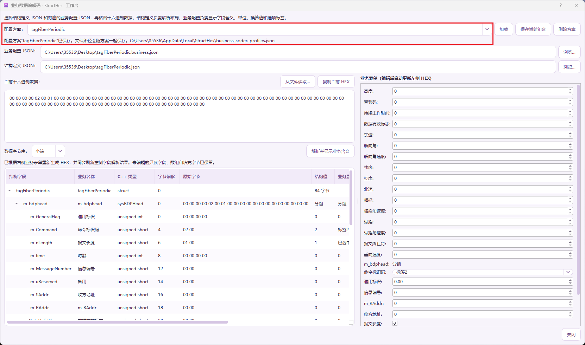

下一次就可以方便地载入了。
